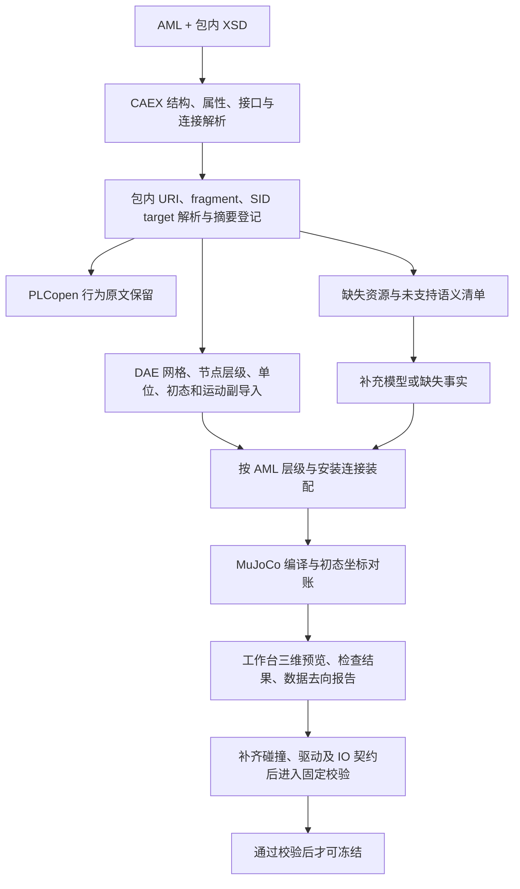
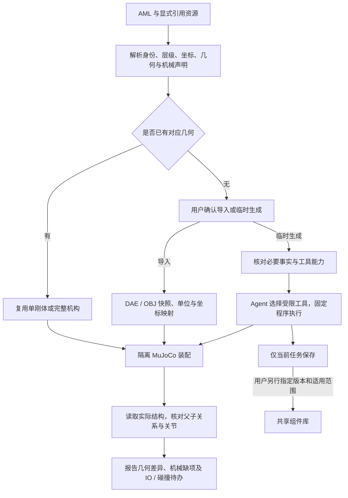

# AML 资源导入与装配

## 2026-11-17 RobotCell 参考场景修正

按用户确认，`AML_RobotCell_en_public/AML_RobotCell_en/AmlDocument.aml` 删除 ST020 整组：
`020RB_100_KR240R2700prime_`、`020GES191` 导轨及滑台、`020GRF141` 随臂夹爪、独立 KRC4 控制柜，
同时移除组内 3 条安装连接。ST020 没有其他设备，因此清理该空结构及父分组。其余 AML 内容与 DAE 资源保持。
当前保留 ST030 的 3 台机器人及 ST010 的 1 台，299 个 AML 组件、15 条安装连接。

既有前端任务 `61831a5482b14d44a93004d26370571d` 的重建目录为 `imported_scene_010_final`；
任务入口和源快照同步新版 AML，旧场景目录保留作恢复记录。IO 配置迁移至
`examples/robotcell/010RB_100.io.json`，变量与寄存器不变，按源组件/关节标识重新定位；
具体通道与测试入口见 `docs/RobotCell独立IO测试.md`。原 AML/IO 备份、编辑审计、重建和测试证据位于
`workspace/2026-11-17-robotcell-010/`。


2026-11-05，gc。本说明针对 `AML_RobotCell_en_public/AML_RobotCell_en/AmlDocument.aml`，记录资源优先的实际导入路径。独立格式为 `308sjk.aml_resource_package/1`，不是原 DeviceIR 或四份 PLC 冻结契约的升级。

## 1. 架构与职责



现有资源由固定导入器读取并装配，不调用 Agent 重建。缺少组件会输出可定位的引用错误；自动调用 Agent 补件尚未接通，也不会拿简化几何冒充导入成功。现有项目自定义 AML 的生成入口保留。资源包有单独 CLI、Web API 和界面入口。

## 2. 包内内容与数据去向

该包有 417 个文件：1 个 AML、1 个 CAEX XSD、406 个 DAE、4 个 PLCopen XML、3 个 VSD、2 个 PDF。AML 通过包内 CAEX 2.15 XSD 校验。实例解析为 323 个组件、329 个实例接口、18 条连接；整份 XML 的 330 个 ExternalInterface 包含类库定义，不能全部计作实例接口。

| 源数据 | 处理方式 | 产物及用途 |
|---|---|---|
| ID、Name、RoleRequirements、包含层级 | 保留稳定身份和原始父子关系；运行装配树单独记录 | `package_manifest.json/components`；`body_mapping.json` 对应 MuJoCo body 与 AML 组件 |
| 嵌套 Attribute、Frame、源 XML 属性 | 保留原值和单位；Frame 默认米、角度度，按 Rz Ry Rx 转为矩阵 | manifest 的 local/world；`scene.xml/body` 的局部平移和四元数 |
| 类库、版本、来源、扩展 | 原文留存；不宣称已实现供应商扩展或通用继承展开 | manifest 的 class_libraries/document_metadata；`source/` 原文件快照 |
| 110 个 explicit COLLADA 引用 | 解析相对 URI、递归 instance_node、场景和几何；按资源路径及 geometry ID 去重 | `meshes/*.obj`、`scene.xml/asset,geom`、`mesh_manifest.json` |
| 109 个 implicit COLLADA 引用 | 在所属已导入实例内解析 fragment 与 target/SID，不重复导入网格 | `data_destinations.json/resources`；对应已有 DAE body 的 AML frame/site |
| DAE unit、up_axis、matrix/translate/rotate | 毫米换算为米，统一 Z 向上；保留原矩阵，导出时消除小量旋转舍入误差 | data_destinations 的 nodes/local,world；MuJoCo 实际初态坐标对账 |
| 网格尺寸 | 从导入顶点计算包围盒和尺寸；不把推导尺寸冒充独立 AML 参数 | `mesh_manifest.json` 的 min/max/dimensions，单位 m，带源文件和 geometry ID |
| triangles/trifans/tristrips | 三角化并保留表面；只有三顶点时作表面细分满足 MuJoCo 顶点数约束，不增厚 | OBJ 和 visual-only geom；表面细分在 mesh_manifest 中登记 |
| 网页显示网格 | 使用编译模型的完整三角面，保留顶点位置、面顺序及朝向，不进行顶点聚类或删面；重复资源复用缓冲 | `/view` 返回网格元数据，`/mesh` 按模型版本传输完整二进制网格；不改 OBJ、MuJoCo 或验收输入 |
| DAE joints/link/attachment_full、axis、limits、bind_joint_axis | 解析参数与 bind symbol；重建运动学父子关系，轴/锚点转到子刚体坐标；转动限位转弧度，移动限位转米，ref 保留绑定初态 | `scene.xml/joint`；assembly_checks 的 joint_records；data_destinations 的 nodes/joint |
| 相等限位的关节 | 按源声明保留固定关系 | 固定 body；与缺失事实造成的临时固定分开记录 |
| 缺少限位/耦合或 UnsupportedType | 保留源声明和初态，记录问题；缺限位关节不作为自由运动轴 | provisional_fixed/source_unsupported；issues 阻止将预览视为可验收模型 |
| AttachmentInterface + InternalLink | 解析 `[组件ID]:[接口名]`；支持资源组件及 Structure 容器。优先移动端作安装宿主，静态连接按源端点顺序选树方向；保留源相对位姿 | 运行 body 父子关系、连接 assembly_status、两端位置/角度残差；闭环/多点安装单列待确认 |
| 4 个 PLCopen 行为引用 | 文件及 globalId 定位，保留 SFC/ST 与 AML 扩展 | `logic_models.json`、`source/LogicXML`；不下发 OpenPLC，不执行额外整机功能 |
| 材质、贴图、源法线、速度/加速度和供应商 extra | 原文件保留，source_inventory 登记；前端按组件类型自动设置显示材质、重算法线，未恢复源贴图；速度/加速度尚未映射到执行器 | manifest 的 unmapped_data；source 快照，不宣称被运行内核消费 |
| VSD/PDF | 说明资料，不参与自动仿真构建 | 原包保留；不复制为已解析运行资源 |

解析使用包内引用白名单，拒绝目录越界、网络资源、DTD/entity 和循环引用；导出前复核已读取资源摘要。源文件名不匹配必须使用显式路径映射，不做模糊匹配。CAEX XSD 验证不等于 COLLADA/PLCopen 完整标准认证。

## 3. 当前缺项与处理边界

1. **安装接口完整坐标**：18 条安装连接中，8 条各有一个 AttachmentInterface 所属 Frame 未显式给出位姿，也没有隐式 DAE 节点绑定，共涉及 8 个不同接口。当前预览继承所属组件原点并标记 `attachment_frame_unspecified`；这不证明位置错误，若设计上接口就是该原点，可以明确确认该基准，否则需补充平移/旋转或资源节点映射。已有源位姿不会被自动吸附或改写。没有容差时，接口残差只作测量，不判定通过。

   例：`Attachment_030RB_100_KR240R2700prime__030WZD180`。机器人一侧通过 implicit COLLADA 引用定位到 `KR240R2700prime_2_AttachmentPoint_030WZD180`；另一侧 `030WZD180_030RB_100_KR240R2700prime_` 只有 AttachmentInterface 和 Frame 角色，没有 Frame 属性及 COLLADA 节点引用。因此能确认连接两端的身份，但不能独立核实另一端的安装偏置。见源 `AmlDocument.aml` 第2566、2788、3750行。
2. **耦合及辅助关节**：缺限位的 533 个关节中，525 个在源 DAE 的 `extra/technique/param[@name="JointType"]` 标注 `Depending Joint with no Limits`，分布于 5 个机器人 Product DAE，各105个。该文字不是关节名称。其余8个未带此标签，不能直接归类为线缆。例：`KR240R2700prime_2_Product.dae` 第1102行的 `dp3_A_JvP_Schlauchpaket` 声明 revolute、轴向 `1 0 0`，未声明 limits，并带该 JointType 标签。标签本身不提供可执行的跟随/耦合公式，当前仅保持初态。

   **用户确认规则（2026-11-05确认）**：疑似线缆及辅助结构提交用户确认，不能仅按名称自动认定非关键。可选择保留外观并固定随指定刚体运动、保留真实运动并补充限位/耦合，或明确排除本次不需要的外观部分。确认须记录目标、源摘要、跟随对象、碰撞参与方式和本场景适用范围；涉及关键尺寸、安装、运动范围、碰撞或 IO 的结构仍须保留相应验证。允许按同类结构成组确认，但不能把一项确认自动扩展到所有未知关节。此段是已确认的处理规范；当前补件界面尚未实现辅助关节专用确认操作。

   实际装配实例记录为981个关节声明：84个可动、364个源限位锁定、533个缺少限位/耦合而仅保持预览初态。200个名称包含 `UnsupportedType=12` 的记录均属于364个源限位锁定关节，不能重复相加。

   **UnsupportedType 的准确含义**：本包中它是源 joint 的 name/id 的一部分，例如 `dp6_1_kugel_UnsupportedType=12`，不是 MuJoCo 返回的报错。当前导入器根据名称子串产生 `unsupported_source_joint` 提示；这只是来源名称标记，不能据此断言实际运动学类型不受支持。复核200项均声明 `JointType=Rigid Joint`，并以 `prismatic`、`min=0`、`max=0` 表达锁定关系。可以核实这些当前文件表达固定关系，但无法仅凭编号12还原更早 CAD 系统的类型；不应凭名称将它们恢复为球副或其他自由运动。该名称的历史来源与最终确认范围应留痕，来源和缺项清单见 `workspace/2026-11-05-resource-clarification/source-audit.json`。
3. **闭环和多点装配**：一组资源被多个接口绑定时，普通 body 树不足以表达全部约束；需要明确刚性闭环、可拆卸安装或状态切换语义。导入器保留连接并报告，不能随意舍弃连接来认定装配正确。
4. **碰撞**：源 CAD 网格不是已验收的碰撞配置。需补充碰撞体、接触排除和允许工艺接触。当前 geom 不参与碰撞，contact 关闭；因此没有“无碰撞通过”的结论。统一质量/惯量及零重力仅用于装配预览。
5. **IO 与驱动**：该包没有当前项目需要的逐点地址、类型、方向、初值、范围、绑定对象/物理量、换算及阈值契约。PLCopen 行为片段不能替代 io_list。还需将速度/加速度映射到控制器，才能进入现有固定双向 IO 校验。
6. **验证判据**：需补充检查目标、容差和超时；资源编译成功不等于模型验收通过。当前始终 `model_frozen=false`、`simulation_acceptance=blocked`。
7. **源包引用问题**：AML 引用 `Behaviour_Clamp_StateChart_AMLextensions.xml`，实际文件名为 `Behaviour_Clamp_StateChart_AMLextensions .xml`。实测通过独立 aliases JSON 显式修正，原文件不改。行为 XML 所引用的 `tc6_xml_v201.xsd`、`AML_addData.xsd` 未随包提供，因此行为 XSD 校验未完成。

## 4. 使用与核对

```powershell
python -m src.agent.scene_agent import-package --aml "<包目录>/AmlDocument.aml" --out "<新的输出目录>"
# 可选：--aliases "<资源路径修正.json>"
```

aliases 示例：

```json
{"LogicXML/Behaviour_Clamp_StateChart_AMLextensions.xml":"LogicXML/Behaviour_Clamp_StateChart_AMLextensions .xml"}
```

工作台“设备场景生成 → 设备与要求 → 从 AML 资源包导入组件”填写后端主机的 AML 完整路径。文件须连同资源目录解压保存；仅上传单个 AML 不会携带 DAE。API `POST /api/device-scene/import-package` 接受 `path` 和可选 `aliases` 字符串映射，沿用现有本机写请求 token 检查。

预览就绪要求 MuJoCo 编译成功且实际几何体数量大于零。仅解析到 AML 层级、没有几何的任务显示“AML 已解析 · 缺少三维资源”，隐藏空画布并展开资源路径导入入口；保留解析事实和逐项缺失报告。编译成功不等于已经装配出可见模型，单独上传 AML 后反复点击重新装配也不会补上传其关联文件。

生成 `package_manifest.json`（总清单）、`data_destinations.json`（节点及资源去向）、`mesh_manifest.json`（几何尺寸）、`assembly_checks.json`（实际编译和安装对账）、`logic_models.json`（行为原文）、`body_mapping.json`（实例映射）、`scene.xml`、`meshes/`、`source/`。缺件及未知语义不会触发 LLM 或自动审批。

真实包实测与浏览器证据保存于 `E:/chagpt/2026-11-05-aml-resource-import/`；最终统计以 `verified/package_manifest.json` 为准。此前迭代目录不作为成功证据。当前实现保留预览与待补充数据，不接入 PLC 生产部署或冻结晋级。

## 5. 用户确认后的资源补全流程（2026-11-05）

新上传 AML 的前端默认入口走资源解析与装配。原有生成/固定 IO 工作流的 API 保留兼容，但不用于标准资源包的缺件补全。



- `resource_resolution.json` 逐组件记录 `resolved / structural / missing_geometry / needs_classification`。明确纯结构节点、Frame 和已映射的隐式节点不重复补模型；不明确的用途由用户确认。
- 前端“检查结果 → 组件资源补全”提供导入、Agent 临时生成、库资源选定和单独入库操作。入口 `POST /api/device-scene/resolve-resource` 需要任务 ID、当前 revision 和组件 ID；忙碌或旧版本请求拒绝。
- 导入 DAE 保留其中独立刚体、网格、内部运动副；OBJ 是单个刚体的三角网格，必须由用户声明单位和向上轴。两者都要明确 `model_to_component` 刚体变换（平移为 m），禁止用缩放矩阵掩盖尺寸差异。接口和连接语义继续取自 AML 或其明确引用。
- 已有完整机构按原运动刚体导入；不能定位内部刚体或隐式映射失效时留下具体缺项。系统不会把整体机器人 OBJ 当成六个可动连杆，也不自动拆分几何。
- 临时生成目前开放 **AML 明确声明的简单方盒**：`primitive_shape=box`、`geometry_origin=center`、`size_x_m/size_y_m/size_z_m` 及完整机械声明均必需。Agent 仅返回 `{"tool":"box","size_parameters":["size_x_m","size_y_m","size_z_m"]}`；固定工具读取 AML 尺寸生成网格，拒绝自由代码、新尺寸和其他组件。其他结构仍显示选择入口，但选择临时生成后会报告不支持的能力或缺项。
- 默认简化范围：允许简化外观、非关键结构及几何细节；必须保留关键尺寸、位姿、层级、安装接口偏置、运动副、速度/加速度、碰撞所需几何及 IO 绑定。不能满足时不得以“简化”为理由放过。
- `package_source/` 保存源快照和本任务补件，`resource_choices.json` 记录用户选择；每次补件生成新的 `imported_scene_<id>/`。失败保留上一份可见场景；成功切换视图，不覆盖原 AML。
- 临时模型不会自动进入共享库或跨任务绑定。重新生成同一 AML 时重新等待选择，选择临时生成会再次调用 Agent。历史任务可以继续查看原模型。
- 用户选定的导入模型或库资源可记录绑定，以 AML 内容摘要和组件 ID 为键；再次导入相同源时校验资源及依赖摘要，失效则重新等待选择。临时生成没有这类绑定。入库需要明确版本和适用范围；入库只表达可供选择，不授予设备验收通过。

## 6. 机械声明归一化与真实结构核对

### 检查结果的显示与独立 IO 状态（2026-11-18）

检查结果将待确认项按问题类型折叠显示，包含中文含义、数量、处理要求和组件／连接名称及层级。原始问题记录仍可展开查看，导入清单不因显示更新而改写；数量按当前任务报告统计，各类问题不能相加作为缺失模型总数。

独立 IO 状态读取现行 IO、adapter、motion 三份配置，并核对当前场景的设备和源关节；源匹配只显示“配置已匹配”，在当前版本 MuJoCo 预览实际通过绑定检查后才显示“已绑定”。缺文件、源关节变化、组件不属于当前场景或绑定失败均不能显示已绑定。报告不访问 PLC、不执行运动，也不把历史联调结果作为当前在线证明。

整场景 IO 验收与组件级独立绑定分别记录。IO 文件仅保存变量映射，连接／周期／指令超时来自适配器，初态／限位来自模型，速度来自运动配置，响应阈值来自验收设置。导入报告中的历史 `io_contract_missing` 原文保留供追溯，页面解释为整场景 IO 验收待完成，不再据此声称已绑定组件无法进行 PLC 控制。

`mechanical_definitions.json` 汇集 AML 内联机械定义、明确引用的外部定义，以及实际导入的 COLLADA 运动学。来源和源单位继续保留。仅有视觉网格引用不等于声明了运动副。

标准 COLLADA 运动学继续按 §2 的 joint/link/attachment_full 和显式绑定解析。项目新增的内联 JSON/外部 JSON 适配是 **项目扩展格式，不是 CAEX 标准字段的替代定义**：

1. 内联：组件 `Attribute Name="MechanicalDefinition"` 的 Value 保存以下 JSON。
2. 外部：组件的 `ExternalInterface RefBaseClassPath="MechanicalDefinitionInterface"` 以 `refURI` 明确引用包内 JSON。
3. 两者同时声明时必须一致；不一致或定义非法时阻止应用该组件声明，不静默覆盖。未知供应商格式继续保留原文并报告未支持。

```json
{
  "format": "308sjk.resource_mechanics/1",
  "interfaces": {
    "mount": [[1,0,0,0],[0,1,0,0],[0,0,1,0],[0,0,0,1]]
  },
  "connection": {
    "type": "slide",
    "parent_component": "base",
    "parent_interface": "mount",
    "child_interface": "mount",
    "range": [0, 0.1],
    "initial": 0,
    "speed": 0.02,
    "acceleration": 0.1
  }
}
```

`interfaces` 是组件坐标中的完整 4×4 刚体变换；平移 m，接口 +Z 为运动轴。根组件 `connection={"type":"root"}`；固定连接使用 `fixed` 和两端引用；可动连接使用 `slide/hinge`、初值、上下限、速度和加速度，移动单位 m、m/s、m/s²，转动单位 rad、rad/s、rad/s²。这些速度参数被归一化保存，资源预览尚无驱动器执行它们。

安装采用声明位姿并核对接口关系（含关节初值），不自动吸附、拉伸或修改事实。循环关系和不一致关系单独报错。缺少明确连接类型的 AttachmentInterface 仍可保留源位姿预览，但标记 `connection_type_unspecified`。

固定检查读取编译后实际 MuJoCo 的 body 父子关系、joint 类型/轴/锚点/限位，核对导出映射，并输出 `assembly_checks.json/structural_checks`；接口生成实际 site，前端模型树展示其名称。几何尺寸差异单独记录，不自动缩放。此处核对的是“声明是否正确进入 MuJoCo”，不替代原始设备事实、安装容差、碰撞配置和双向 IO 校验。

资源包的 IO/碰撞运行适配仍未实现；RobotCell 本身也缺少当前项目需要的逐点 IO、容差等信息。该路径维持禁止冻结，不因新增结构检查而宣称完整验收通过。原独立 DeviceIR 固定 IO 流程不变。

本轮可复查产物：`workspace/2026-11-05-resource-workflow/`，包含真实 RobotCell 装配、回归报告、浏览器操作证据和截图。浏览器验证导入和显式入库不调用模型 API；临时生成编排通过注入 Agent 响应测试，未把本次资源包发送到外部模型服务。

## 7. 关节位置预览（2026-11-16）

采用用户选定的第 1 版布局：左侧组件树、右侧大画面、初始位于画面底部的关节控制。控制面板可通过标题栏拖动、右下角手柄调整大小；窄面板切换为单列，列表内部滚动，面板保持在画面范围内。右键按鼠标方向平移模型视图，左键旋转沿用模型中心；视图操作不修改关节状态。选中组件后，面板列出该组件及其 AML 子组件所属的实际 MuJoCo 关节；常显关节 ID、当前位置、目标输入及其右侧限位，悬停 ID 可查看源名称、运行时名称和 `jnt_qposadr`。转动关节用度、移动关节用毫米显示和输入；接口传输使用 rad/m。球副、自由关节只显示状态，当前不提供位置命令。

用户选择位置预览模式：默认 2 秒，可设置 0.1～120 秒，以平滑插值更新独立 `MjData.qpos` 并执行 `mj_kinematics` 计算正向运动学姿态；前端以 30 Hz 为更新目标，不叠加未完成的帧请求。单关节和多关节命令、停止保持当前位置、所选组件恢复模型初始姿态均可用。动画仅验证运动学姿态，不使用执行器动力学，不构成碰撞或 PLC 验收。

提供完整场景、当前工位、仅显所选、隐藏所选和树节点独立显隐，搜索可展开匹配路径；默认选择组件后隔离显示，可选择带上实际装配在其下的附件。显隐仅影响画面和拾取，不改变装配结构。提示线使用后端每帧 `MjData.xanchor` 世界坐标，跟随关节运动与相机视角。

静态网格仅在加载时传输，运动帧传输几何变换、关节状态及锚点。预览复用编译模型；每个页面拥有独立的临时状态，最多缓存四个页面会话，淘汰后回到初态。原 AML、scene.xml、io_map、审批和冻结记录不因预览操作改变。

`GET /api/device-scene/joint-state` 按任务、页面会话、模型版本和组件集合返回关节元数据或运动帧；`POST /api/device-scene/joint-command` 使用已有页面令牌认证，支持 move/stop/reset。后端从编译模型读取真实 `jnt_qposadr`，不假设索引等于 joint_id；校验组件归属、关节类型、有限值、限位、时长及模型版本，批次校验通过后才改变目标。模型或归属文件变更时拒绝旧版本命令，下次加载重新编译和解析索引。切换模型或选择时停止旧预览，测试回放与位置预览不同时控制画面。

实现位于 `src/agent/scene_agent/joint_preview.py` 与 `src/agent/web_ui/joint_preview.js`，接入既有工作台和查看器；原四份冻结契约不变。验证证据保存在 `workspace/2026-11-16-joint-preview/`。

第1版正式布局与清理验证：`workspace/2026-11-16-layout-01/`。旧七版预览服务8766已停用，对应预览文件和缓存已删除。


## RobotCell 独立 IO 实验（2026-11-17）

020RB_100_KR240R2700prime_ 的六轴位置 IO 以独立配置完成绑定，定义、运行方式和验证状态见 [RobotCell独立IO测试](RobotCell独立IO测试.md)。原 AML 未补写 IO。独立 OpenPLC 8081/1502 实例真编译及完整模型六轴双向 IO 真实联调通过（14 周期，最终使能清零），证据 workspace/2026-11-17-robotcell-modbus/live/acceptance.json。

前端“执行所选关节”右侧增加“PLC控制”，通过同一 IO 适配器将 PLC 输出作用于当前预览会话，并显示已被 PLC 确认反馈的 MuJoCo 状态。仅控制勾选关节；未完成绑定的组件按钮灰色不可用。原 joint-command 接口新增 plc 动作，沿用令牌、组件归属、限位和模型版本校验；配置变更也使旧预览版本失效。停止清除使能并保持最后确认位置。仍是位置预览 IO 验证，不改变资源场景未冻结及其他缺项的结论。


## 自动显示材质与阴影（2026-11-17）

设备前端默认启用显示材质：资源包按组件类型采用机械臂橙色涂装、夹具金属灰、机架蓝灰及机器青色；已有非资源包场景保留其声明颜色。粗糙度和金属反射控制高光，方向光、环境光及补光提供明暗层次；选中组件保留材质并增加青色边缘光，碰撞警示颜色仍优先。

使用2048像素深度阴影贴图及3×3过滤，产生模型自身和地面投影。只计算当前可见几何，模型静止时复用阴影；关节姿态或显隐变化后更新。地面为前端显示对象，不加入MuJoCo、碰撞、组件树或IO，也不参与拾取。几何边界来自实际顶点及当前刚体变换；切换展示范围重新定位地面，运动中保持地面高度。阴影缓冲不可用时仍显示材质与光照。

实现位于scene_view.js中的SceneAppearance，由device_scene.js启用。原始DAE材质与贴图仍只保留在源文件中，当前自动配色是显示规则，不代表设备真实表面参数。证据workspace/2026-11-17-auto-render，包含实际RobotCell截图和浏览器检查。

验证：全量1049项、专项13项和实际Chrome12项检查通过；观察到约29～30Hz刷新。原10份任务/模型记录摘要一致，详见该目录pytest-full.log、browser-report.json及source-integrity.json。


## 前端保留完整网格（2026-11-17）

按用户要求移除网页的60万三角面预算和顶点聚类减面。package_preview直接打包当前编译模型的所有三角面，保留面顺序、朝向、顶点坐标，微小面及退化面也不删除；坐标采用WebGL原有的float32表示，法线仍按面计算。源文件在导入阶段已经完成的三角化不在本次修改范围内。

完整RobotCell网格不再嵌入单个Base64 JSON。geometry返回每个资源的顶点数、字节数及带任务/模型版本的二进制地址，浏览器最多四个请求并发下载，上传GPU后释放临时CPU缓冲。重复实例仍共享同一网格缓冲；这是存储复用，不改变网格划分。模型版本过期或网格不存在时拒绝请求，切换/重置场景取消旧下载，失败下载释放新建缓冲并允许重试。

材质、光照、动态阴影、显隐、关节及PLC控制沿用现有功能。显示面数和原始面数一致，preview_quality.simplified=false，max_vertex_displacement_m=0。本轮验证与截图保存在workspace/2026-11-17-full-mesh。

本轮验证：全量1050项、专项32项和Chrome13项检查通过；实际940份网格资源的原始面数、显示面数及GPU独立面数均为6,844,417。10份源任务/模型记录摘要一致，证据见本轮目录的browser-report.json、pytest-full.log和source-integrity.json。

## 渐进式装配显示（2026-11-18）

资源导入器在真实 DAE 组件解析完成后发布只读预览，并在隐式引用、安装关系归位后更新坐标。新增 assembly-view / assembly-mesh 接口按任务和临时版本提供快照与完整网格；共享几何只打包一次。预览只保留最近一次导入，最终编译模型接管或服务关闭后释放，不写入 AML、IO、MJCF 或验收结果。

前端按组件层级组织显示顺序，等待组件自己的网格全部下载，再以短距离下降动画归位；完整网格仍使用四路下载和共享 GPU 缓冲。动画偏移只在绘制时计算，原始变换及 qpos 不变。导入中展示已解析资源，最终切换到实际编译的 MuJoCo 几何；普通场景加载也使用渐进显示。装配画面以30 Hz刷新，加载时使用浅色背景和临时进度，开始新装配时收起导入设置。

只有最终几何下载完成、动画归位后才开放关节控制版本；任务切换取消旧请求，旧响应不能覆盖新模型。失败保留错误和当前预览，禁用控制，允许重试。已载入模型的颜色、材质、光照、阴影、显隐及原控制功能沿用。动画不是物理安装仿真，也不代表通过 IO 或整场景验收。

全量1098项及43项专项通过，真实RobotCell重新导入验证了 busy 阶段可见组件、最终编译模型切换和完整网格加载。证据保存在workspace/2026-11-18-assembly-animation。
