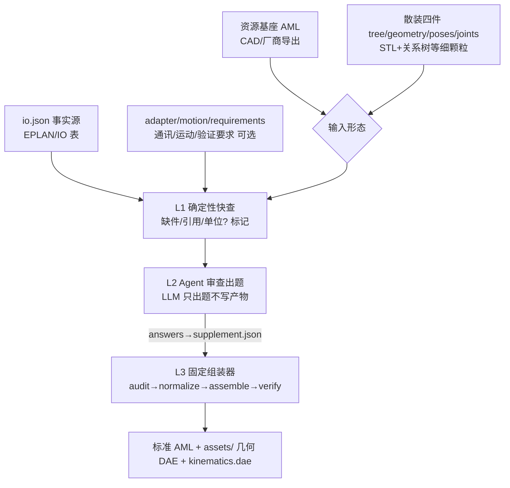

# 标准 AML 配置器与四侧消费

2026-11-23，csk。本文回答四个问题：标准 AML 文件应该是什么样的（对照 IEC 62714 与
官方工业实例逐项确认）；配置器产物是否达标（符合度矩阵，含 2026-11-23 整改）；
信息从哪里来、如何审查（L1/L2/L3 流程）；组装完成后如何拆分给四侧消费（⓪/lx/通讯/仿真）。

工具入口：`tools/aml_configurator.py`（固定组装器）、`tools/aml_agent_configurator.py`
（审查问答前置层）、`tools/aml_configurator_web.py`（Web 前端 :8766）、
`tools/aml_parts.py`（散装四件→基座）、`tools/aml_to_mjcf.py`（仿真侧消费）。
实验证据：`tools/tests/`（12 项）、`workspace/aml_configurator/`。

## 1. 标准 AML 文件应该是什么样的

对照物：官方 AutomationML 教程工业实例 `AML_RobotCell_en_public/AML_RobotCell_en/`
（CAEX 2.15 + COLLADA 1.5，4 机器人单元）。一份"标准"的 AML 应同时满足三层要求：

**① XSD 合法（CAEX 2.15 硬约束）**——元素顺序严格（Attribute→ExternalInterface→
InternalElement→…→RoleRequirements 最后；InstanceHierarchy 只允许 InternalElement）。
这是最低门槛，违反即不是 CAEX 文件。

**② IEC 62714 惯例（工程互操作层）**——官方实例展示的关键惯例：

| 内容 | 标准载体 | 官方实例的做法 |
|---|---|---|
| 结构层级 | CAEX InternalElement 嵌套（ID/Name/parent） | Station→设备→部件多层嵌套 |
| 位姿 | Attribute `Frame`（x/y/z/rx/ry/rz） | 组件首属性 |
| 几何 | COLLADAInterface refURI → .dae（refType=explicit） | 197 处 `dae_lib/*_Rep.dae` |
| 运动学 | **COLLADA 1.5** `library_joints`/`kinematics_models`/`articulated_systems`/`kinematics_scenes`，AML 侧 COLLADAInterface fragment 引用 | `*_layout_kin_Product.dae`（铰链+限位+link 树+参数绑定链） |
| 控制逻辑 | PLCopenXMLInterface refURI | LogicInterface×4（本项目归 lx 侧，不进配置器） |
| 电气接线 | InternalLink（信号接口×PLC 端子） | 端子 PortInterface |
| 自包含 | 文件末尾内联 InterfaceClassLib/RoleClassLib 声明 | AutomationMLInterfaceClassLib + 4 个 RoleClassLib |
| 写出者 | AdditionalInformation→WriterHeader | AutomationML e.V. 工具信息 |

**③ 项目契约（308sjk 分工层）**——信号类 AnalogInput/AnalogOutput（接口类视角
dir=input→AnalogInput）、地址 %QX/%QW（%QD 禁用）、INT16 量程落域、
SimulationRequirements 挂 Station、`308sjk.standard_aml/1` 格式标识。

## 2. 符合度矩阵（2026-11-23 复查 + 整改）

| 检查项 | 整改前 | 整改后 |
|---|---|---|
| CAEX 2.15 XSD | ✅ 一直通过（verify 内置 xmlschema） | ✅（含新元素重验） |
| 结构/位姿/几何引用/IO/接线 | ✅ 已按官方惯例 | ✅ 不变 |
| **运动学标准载体** | ❌ 仅 AML `Kinematics:*` 属性（项目内部约定，第三方工具不可见） | ✅ 另生成 `assets/kinematics.dae`（COLLADA 1.5，结构照官方 kin DAE：joint 规格、link 树 attachment_full、articulated_system/kinematics_scene 参数链），AML 侧 `Kinematics` COLLADAInterface fragment 引用，refType=implicit（gc 导入器只加载 explicit 几何，不会误当网格） |
| **自包含类库** | ❌ 引用 AnalogInput 等类但未声明（官方内联库也不含信号类） | ✅ 散装模式内联最小 InterfaceClassLib+RoleClassLib（含信号类）；打包模式在基座内联库补声明。verify 新增自包含审查：全路径类引用须可解析 |
| **WriterHeader** | ❌ 散装无；打包沿用基座（写出者标 AutomationML e.V.） | ✅ 两种模式均声明实际写出工具（308sjk aml_configurator 1.1）；时间戳用固定纪元保持确定性（同输入同输出） |
| RoleRequirements | ❌ 散装组件无 | ✅ 叶子=Resource、结构组=Structure/ResourceStructure（官方惯例） |
| 物理属性（质量/质心/惯性/扭矩） | ❌ 无处可放 | ✅ geometry.json 可选 mass/com/inertia/density、joints.json 可选 torque → AML `Physical` 属性/关节 torque 属性 → MJCF inertial/forcerange |
| 铭牌（厂商/型号/负载） | ❌ | ⚠️ 经 L2 param 问答→Attribute 透传（有位置放，数据来自手册） |

验证：打包产物重生成后 XSD 过/⓪回读 14/14/自包含 101 类全解析；
散装产物 XSD 过/kin DAE 6 关节过审查；MJCF 回归 body=7 joint=6 闭环误差 0.0°；
`tools/tests` 12/12 绿。

**已知边界（如实声明）**：kin DAE 是纯运动学文件，无视觉场景绑定（几何绑定走 AML
各组件 Representation 接口，与官方"几何+运动学分文件"用法一致）；
`Kinematics:*` 属性与 kin DAE 并存（同一 joints.json 确定性生成，不发散；属性供
gc/aml_to_mjcf 直接消费，kin DAE 供第三方 AML 工具）；joint velocity 进 AML/kin DAE
但未映射 MJCF 速度限位（位置伺服验证不需要）。

## 3. 输入体系：信息从哪来、如何审查

- **获取**：几何=CAD 导出 STL/DAE（单位 mm 需问答确认，野生 STL 兜底标 `?` 强制问答）；
  结构=关系树或基座 AML；IO=事实源 io.json（名称/地址/量程/scale/溯源）；物理与铭牌
  =厂商手册（可选字段，缺省降级：MJCF 按几何密度自动推惯性）。
- **审查**：audit 8 类硬规则（引用存在/地址冲突/%QD/枚举/source 成对/量程落域/类型）
  errors 阻断；L2 问答补单位/位姿/配对；verify 四重自检（well-formed+XSD+⓪回读逐字
  比对+自包含/kin DAE 一致性）。
- **确定性**：L3 同输入同输出（可 diff 可回归），WriterHeader 时间戳固定纪元。

## 4. 下游拆分：标准 AML 如何驱动整个系统

一份标准 AML 同时是四个消费侧的唯一取数源，名称统一由此保证：

| 消费侧 | 入口 | 读取内容 | 产物 |
|---|---|---|---|
| ⓪ gc 需求侧 | `src/agent/aml_parser.py` | ExternalInterface 信号类（含 input/output）→ io_points；组件树→devices；InternalLink→拓扑 | device_model + requirement_spec.io_list（PLC 代码生成的输入） |
| lx PLC 侧 | `tools/aml_export.py --st` | 信号 name/address/type | ST 变量声明（`rb100_j1_target AT %QW100`，名称≡AML≡io.json） |
| 通讯侧 | `tools/aml_export.py --modbus` | address/scale/range | Modbus 通道表（FC03/06/16、偏移、raw_to_eng） |
| gc 仿真组装 | `src/agent/scene_agent/package_import.py` | COLLADAInterface(explicit)→网格/单位/初态；组件层级→装配；IO→body_mapping | scene.xml + mesh（MuJoCo） |
| csk 仿真验证 | `tools/aml_to_mjcf.py` | source_file/source_id→DAE 轴向（散装回退 AML 关节属性）；range→限位；target/actual→执行器/传感器命名；Physical→inertial/forcerange | MJCF + 编译闭环冒烟 |

关键设计：PLC 程序本体（PLCopen XML）**不进**标准 AML——lx 侧独立生成，两者耦合点
是 IO 层（名称/地址/量程三重统一）；仿真侧消费 AML 的信号语义命名，故 PLC 变量、
Modbus 寄存器、MuJoCo 执行器/传感器三者名称天然一致。

## 5. 装配与 IO 绑定页（原《复杂仿真模型装配与IO绑定说明》的适配版，2026-11-23）

原说明的输入是"AML + DAE + 独立 IO 配置文件"；适配后收敛为**单份标准 AML**：
`tools/aml_assembly.py`（核心）+ `tools/aml_assembly_web.py`（:8767）+ `aml_assembly_ui/`。

- **解析装配**：InternalElement 层级 + Frame 逐层累积世界位姿；COLLADAInterface(explicit)
  → DAE 几何；Kinematics 属性 → 关节（含 torque）；InternalLink → 电气接线；
  关系不明确项记入**待确认项**（原说明 1.2(3) 同法，如 link6 无显式几何）。
- **MuJoCo 生成**：层级→body、Frame→pos/euler、可动→joint、几何→geom(mesh OBJ，
  不可解析降级胶囊)、IO 接口锚点→site、target/actual→actuator/sensor（命名=信号名）；
  保存 mapping.json（AML 组件 ↔ 仿真节点）。伺服 kp=800 + implicitfast
  （重力负载下 6/6 收敛到 angle_tolerance 0.057°）。
- **IO 绑定**：信号自带 binding 三元组（component_id/source_file/source_id），
  适配器 `IOSession` 双向读写 + raw×deg_per_count 换算；%QWn→Modbus offset n 通道表。
- **IO 测试**：固定规则 → io_test.xml（过 xml2st 结构闸门并转 ST，变量声明含全部
  AT 地址 + prog_id%QW20 辅助寄存器）+ plc_test_contract.json；验收按
  SimulationRequirements 容差逐关节裁定（目标→伺服→反馈→扫描确认），OpenPLC 未接入时
  如实标注"扫描替身"。
- **前端**（http://127.0.0.1:8767）：three.js 3D 装配链（含关节轴向箭头/自动取景/选中
  高亮）、组件树+详情、信号绑定表+接线、raw 滑杆发指令实时看反馈与 feedback_seq、
  一键验收报告、七类产物下载。浏览器实测通过（滑杆闭环/验收 6/6/3D 渲染）。
- **RobotCell 打包模式演示（2026-11-23 三）**：前端第二个示例按钮直接消费
  `examples/aml/standard/010RB_100_standard.aml`（= 原 AmlDocument.aml + 14 点 IO，
  几何装配 100% 来自官方原件）。适配要点：官方运动学在 COLLADA 1.5 DAE 里——装配器
  按信号 source_file/source_id 从 DAE library_joints 提取关节规格；同组件多关节 →
  链式子 body（首关节挂组件体，后续 0.35m 链）；Attachment_COLLADA 的 fragment 引用
  甄别为运动学引用不当几何；106 个显式几何中 77 个真实网格装载（确定性降采样：编译
  ≤4000 面/网格、前端 ≤1000 面/网格+全局面数上限，磁盘缓存加速复跑）、COLLADA 1.5
  Product 网格 pycollada 不支持→胶囊占位并记待确认项；IO/运动学验证场景关闭碰撞+
  gravcomp 重力补偿+伺服 kp=4000/damping=50（动力学/碰撞保真归 gc 资源导入器，如实
  记录）。302 组件/308 body 编译、验收 6/6、浏览器实测真实工厂单元（围栏/工位/机械臂）
  渲染与滑杆闭环。
- 输入样例：`examples/aml/standard/parts_demo/`（散装六轴 → 标准产物 → assembled/ 全套）。
  测试：`tools/tests/test_aml_assembly.py` 6 项（解析/编译/PLCopen+ST/闭环验收/打包
  RobotCell/服务级）。

## 6. 迭代记录

- 2026-11-23：对照官方实例复查 IEC 62714 符合度，实锤三大缺口（运动学载体/自包含/
  WriterHeader）并修复；新增物理属性与扭矩通道（AML→MJCF）；verify 新增自包含与
  kin DAE 审查；测试 12/12；打包产物重生成。证据：本文矩阵 + `tools/tests/`。
- 2026-11-23（二）：原装配功能适配标准 AML——单输入全链（解析装配/MuJoCo 生成/IO
  绑定/固定规则 PLCopen+ST/闭环验收）+ Web 前端（:8767）；夹具位姿修正（5m→0.35m）；
  测试 17/17。见 §5。
