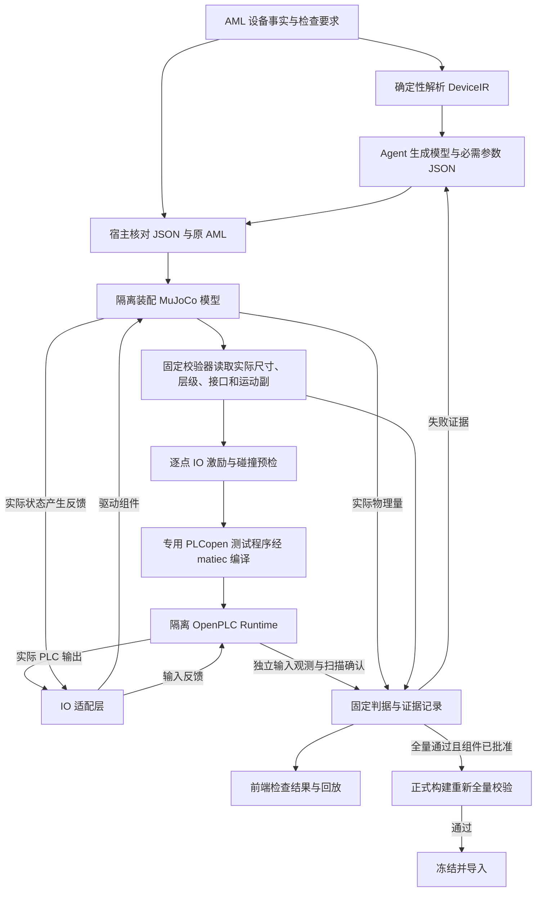

# 模型生成与固定 IO 校验规范

2026-11-03，gc。本文记录用户确认的新方案及本地实现。新任务默认采用 `fixed_model_io/1`，旧任务保留原校验入口；不修改原四份冻结 PLC 契约。六轴已完成真实 OpenPLC 端到端联调：16 项结构检查、25 项 IO 检查通过，证据见 §6；该结论不扩展为其他设备或整机功能验收。

## 1. 检查范围和职责

当前只检查模型尺寸、空间与安装关系、运动副及逐通道 IO 绑定，不增加整机工艺、故障策略、联锁流程、全行程可达性或动力学精度验收。

| 角色 | 职责 |
|---|---|
| AML | 保存设备事实、接口坐标系、运动范围、速度/加速度、IO 绑定和验证要求 |
| Agent | 生成候选模型；提取 AML 必需参数，输出供固定校验器使用的 JSON；不生成校验脚本、判据或通过结论 |
| 确定性适配层 | 校验参数 JSON 的格式、单位、引用与覆盖，并与原 AML 解析结果逐项核对；绑定源文件与实际模型版本 |
| 固定校验程序 | 加载隔离模型、读取实际模型参数和连接关系、生成固定规则约束下的测试激励、执行碰撞预检和 IO 测试、裁定并保存证据 |
| OpenPLC 测试程序与 Runtime | 在隔离测试环境中产生声明的 PLC 输出，并提供 PLC 实际读取输入的观测证据；不执行设备整机工艺 |

任何未知参数、缺失目标或未实现的物理量检查均明确记录为未覆盖，不允许 Agent 通过删目标或自报期望值通过。Agent 的参数 JSON 必须与原 AML 核对，不能作为独立真实性来源。

## 2. AML 必需信息

### 2.1 模型尺寸、位置与安装

- 稳定组件 ID、组件类型和层级。
- 关键组件尺寸与位姿；尺寸、位姿的单位和参考坐标系必须明确。
- 安装接口归属及连接两端；接口偏置是完整的平移和旋转信息。
- 运动副类型；轴向和锚点由安装接口的完整坐标系按固定约定推导。
- 关节初始值、上下限，用于初始化与限制测试动作，不要求做全行程扫描。
- 在上述信息基础上补充模型生成和碰撞检查所需的几何参数、碰撞体及环境关系。

实现约定为 `interface_positive_z/1`：接口局部 +Z 是运动正方向，轴向转换到子组件坐标系，接口原点为锚点。AML 设置 `joint_frame_source=interfaces`，或省略显式轴向时，解析器从连接两端的完整接口坐标推导；同时提供显式值时必须一致。旧 AML 有显式轴向时标记 `legacy_explicit`，不自动改写既有安装事实。

普通组件位姿作为层级坐标变换依据；接口安装求解与声明位姿不能各自给出互相矛盾的装配结果。发生冲突必须报告，不能悄悄改位置或用外观几何中心替代安装接口。

### 2.2 运动和仿真基础配置

运动学参数保留速度、加速度。质量、惯量、阻尼等采用统一、版本化的基础仿真配置，不作为 AML 必填事实，也不验证其是否符合实机。

统一基础配置仍需要使 MuJoCo 模型可运行；位置、速度等有限值和基础数值健康检查继续保留。通过执行器驱动并读取实际状态，可以形成绑定和响应证据，但不形成真实动力学精度结论。

### 2.3 IO 和验证要求

每个 IO 声明名称、方向、类型、地址、初值、范围、绑定对象、物理量、换算系数和适用的响应阈值。方向以 PLC 为参照。通道写入职责由固定适配规则管理，测试程序不能直接改写仿真反馈冒充实测结果。

验证要求包含检查类型、目标、容差和响应超时。检查目标覆盖必须来自声明；测试脚本没有修改这些值的权限。

### 2.4 通用允许简化项

允许简化模型外观、非关键结构及几何细节，必须保留关键尺寸、位姿、层级、安装接口偏置、运动副及速度参数，并保持碰撞检查所需的几何特征和 IO 绑定关系。

速度和加速度均按声明保留。简化外形不能移动接口、改变轴向/初态/限位、删除影响检查的障碍或改变 IO 绑定。此规则为通用配置，不要求每个设备重复自由编写。

## 3. 参数 JSON 的内容边界

产物为 `verification_parameters.json`，格式 `308sjk.verification_parameters/1`，结构见 `schemas/scene_agent/verification_parameters.schema.json`。Agent 的参数提取入口使用确定性 AML 投影；宿主再次逐项对账，拒绝新增断言、修改参数或删减覆盖。

| 分组 | 内容 | 固定适配层的处理 |
|---|---|---|
| 来源与版本 | 格式版本、AML 摘要、组件/接口稳定 ID、字段来源定位 | 与原 AML 对账；模型摘要由宿主从实际产物计算，不相信 Agent 自报 |
| 组件 | 类型、关键尺寸、层级、位姿 | 统一单位，校验引用和几何量测口径；不把全局包围盒尺寸当作任意零件尺寸 |
| 接口与连接 | 接口所属组件、局部平移/旋转、连接两端、安装偏置 | 独立计算装配变换、锚点和运动轴，检查关系一致性 |
| 运动副 | 类型、两端引用、初始值、上下限、速度、加速度 | 核对实际编译模型和运行时配置；限制合法激励 |
| IO | 名称、方向、类型、地址、初值、范围、绑定对象/物理量、比例、响应阈值 | 解析为具体通道路由；与实际模型属性、执行器和反馈源对应 |
| 检查要求 | 检查类型、目标、容差、响应超时 | 编译固定检查计划；禁止接收 Agent 生成的断言、脚本或 verdict |

## 4. 固定校验流程

AML → 确定性解析与 Agent 建模/参数提取 → 参数 JSON 与 AML 对账 → 隔离装配模型 → 固定结构检查 → 合法激励及碰撞预检 → 隔离 OpenPLC 双向 IO 测试 → 保存结果与回放。

首先读取实际编译模型的几何、位姿、刚体层级、关节和接口关系，与已核对的 AML 参数比较。不能只比较模型元数据里的 AML 副本；几何尺寸也必须有明确的实际量测依据。

逐通道测试使用小幅、可辨识的合法激励，验证前置状态满足要求；未被声明关联的其他通道不得发生错误路由变化。初态干涉先报告模型问题，动作路径干涉先拒绝工况。全行程限位不能作为 IO 测试的默认运动目标。

### 4.1 PLC 输入链路

固定测试程序改变 MuJoCo 中绑定对象的实际物理量或声明状态 → 正常反馈内核产生 IO 值 → 适配层传递到 OpenPLC → 观测 PLC 测试程序实际读取的值 → 按换算关系和容差判定。

禁止直接写反馈变量替代实际状态变化。只有本地反馈值或总线写入成功，没有 PLC 侧接收证据，不能判定完整输入链路通过。

### 4.2 PLC 输出链路

固定测试程序给 OpenPLC 测试程序施加测试请求 → PLC 程序产生声明的输出 → 适配层读取输出并驱动模型 → 读取 MuJoCo 实际物理量 → 按目标、响应阈值及超时判定。

测试器直接写目标输出寄存器再读取回显，不等于证明 PLC 程序下发输出。不能直接设置关节位置冒充执行器响应。

输入注入与输出驱动分别形成证据；准备测试所需的使能、初态和复位是测试前置条件，不扩展成整机控制功能验收。

### 4.3 隔离性与结果

使用独立的模型实例与测试专用 PLC 程序/地址空间，记录模型、参数、校验程序及 PLC 测试程序版本。不覆盖现有生产任务、批准记录或运行中的无关 PLC 程序。

结果区分模型结构错误、IO 绑定/换算错误、驱动响应未达标、测试工况不合法、PLC 通信/运行环境问题以及未覆盖项。通过范围只包含上述模型与 IO 检查，不声明整机功能或实机等效性。

## 5. 实现模块与使用

| 模块 | 职责 |
|---|---|
| `verification.py` | 参数 JSON 提取与对账、接口轴约定、统一基础物理配置 |
| `fixed_tests.py` | 固定结构及逐点 IO 检查，使用实际 MuJoCo 几何、刚体和关节；保存回放与逐点 PLC 扫描证据 |
| `plc_test.py` | 生成测试专用 PLCopen `io_test.xml` 及 `plc_test_contract.json`；Modbus 请求、提交、扫描确认与独立观测 |
| `workflow.py` | 新任务默认固定配置，取消 Agent 动作编排；候选模型先校验，全部通过后才能冻结 |
| 网页检查结果 | 配置专用 OpenPLC Runtime、执行检查、选择模块和回放、下载参数与测试程序 |

新配置不进入旧整机分拣夹具。质量、阻尼、摩擦和伺服增益由 `308sjk.basic_physics/1` 提供，惯量由近似几何计算；这些值记录在产物中，不是设备真实物理精度的验收依据。尺寸当前支持组件局部 XYZ 外包尺寸：`size_x_m/size_y_m/size_z_m` 或 `width_m/depth_m/height_m`，从编译后的实际几何量测，不读取声明副本作实际值。

上传资料不足时仍可解析、建模和预览，缺失检查要求或可量测尺寸的项目为 `blocked`。当前固定机械检查覆盖 hinge/slide、固定安装及比例耦合；动态工件生成池的原型位置/尺寸专用检查尚未实现，会明确未覆盖。未知内核和未覆盖物理量也不能通过。

PLC 测试需要独立 Runtime，先部署当前任务下载的 `io_test.xml`。该程序只做 IO 绑定激励与观测，不执行整机工艺。宿主先核对完整程序身份摘要，只写输出请求暂存区；PLC 扫描将请求写到 AML 输出，再把实际读取的输入写到独立观测区，最后确认序列号。输入线圈采用现有 `SafeCoilIO` 整组读改写适配；判据依赖 PLC 独立观测和扫描确认，不把写回显当作收到。

前端在“检查结果 → 隔离 OpenPLC IO 校验”填写专用 Runtime 的地址与端口。命令行等价入口：

```powershell
python -m src.agent.scene_agent check --task <任务目录> --candidate-validation --plc-host <隔离Runtime地址> --plc-port 502
```

未连接、程序身份错误或通信中断时不通过；新一次检查先撤销旧通过状态和冻结标记。全量通过及组件审批后才可冻结导入，选跑子集不能替代全量检查。旧任务可读，CLI `prepare --verification-profile legacy` 仅保留历史流程兼容，不是新任务自动回退。

## 6. 验证边界

真实六轴使用既有 Agent 生成的几何重新隔离装配。首次联调受主机网络阻断；2026-11-03 恢复 VMware NAT 服务、添加通往 192.168.12.131 的临时主机路由后，在独立容器 `openplc-io-test-20261103`（Web 8081 / Modbus 1502）完成真实 matiec 编译和运行。实际 MuJoCo 与 OpenPLC 联调 41/41 通过：16 项结构检查、25 项 IO 检查，577 次扫描确认，用时约 22.36 秒。测试源 AML 摘要与用户指定目录的 `simple_6axis_robot.aml` 相同。部署日志、程序身份、逐点扫描证据和回放保存在 `E:/chagpt/2026-11-03-openplc-live/`；原容器 8080/502 的程序未被替换。

真实 MuJoCo 配合扫描型测试替身另覆盖身份不匹配、超时和错误反馈；替身结果只作自动回归。本次真实测试沿用已生成模型，不代表重新调用外部 Agent，也没有替用户审批或冻结模型。

候选/正式构建仍各自重新校验，原冻结运行链路保持约束。将完全相同的不可变模型包直接晋级导入仍是后续独立工作。旧 Agent 脚本和全行程规范保留作历史记录，不再是新任务的必要步骤。

## 7. 当前 AML 文件与架构

核对目录：`D:/RSsources/Project_competition/西门子AI/博途/`。

| 文件 | 组件节点（含运动副节点） | 运动副 | 接口 | 连接 | IO |
|---|---:|---:|---:|---:|---:|
| input.aml | 18 | 1 | 56 | 28 | 19 |
| simple_6axis_robot.aml | 16 | 6 | 75 | 37 | 25 |

两份文件都以 CAEXFile 为根：SourceDocumentInformation 保存来源；InstanceHierarchy 保存设备实例，InternalElement 表达组件层级，Attribute 表达参数，ExternalInterface 表达接口，InternalLink 表达连接；InterfaceClassLib、RoleClassLib、SystemUnitClassLib 分别定义接口、角色及设备类型。SimulationRequirements 声明检查要求。接口计数同时包含机械与 IO 接口，不等于机械安装接口数。

逻辑上分为设备身份、组件/机械关系、几何与空间、运动参数、IO 绑定、验证要求六组。参数进入 DeviceIR 后统一单位与引用，再投影为 verification_parameters.json；固定检查器读取实际编译模型核对。执行结果、PLC 扫描与回放保存在任务产物中，不写回 AML。

当前源文件尚保留旧质量/阻尼等物理字段，以及全行程/整机行为检查说明；新配置使用统一物理近似并只执行结构和逐点 IO 检查。两份文件的显式轴向/锚点仍标记 legacy_explicit，未全部迁移为安装接口坐标系推导。PLC 输入/输出按 PLC 视角解释，不能单凭共享存储地址 %QX/%QW 推断逻辑方向。分拣线的动态工件原型与部分旧尺寸表达尚有未覆盖项，六轴通过不代表分拣线已经通过。



图中的反馈修复不允许改变 AML 事实或固定判据；测试程序由固定模块产生，Agent 不设计测试脚本。运行时断连、测试工况非法或检查未覆盖均不能进入通过分支。
